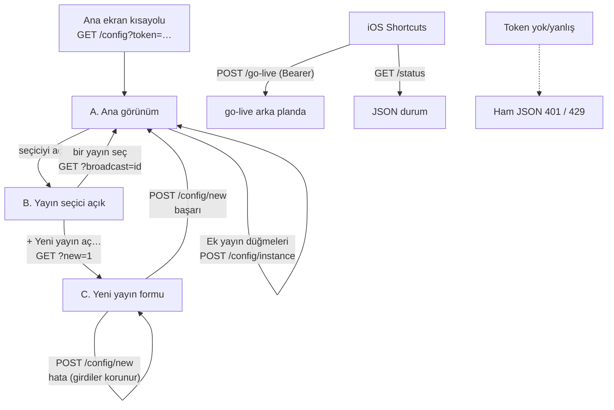

# Mobil Arayüz Analizi (`/config` sayfası) — 11 Ekim 2026

> Salt okunur analiz. Hiçbir kaynak kod, config veya bağımlılık değiştirilmedi; tek çıktı bu dosya.

## 0. Kapsam ve en önemli tespit

**Projede yerel bir mobil uygulama YOK.** React Native / Expo / Flutter / Capacitor / Android / iOS proje dosyası, navigation kütüphanesi, onboarding veya giriş/kayıt ekranı bulunmadı (`package.json` bağımlılıkları yalnızca `ink` + `react`; ikisi de terminal arayüzü için).

Telefondan kullanılan "mobil uygulama" şudur:

| Parça | Ne | Nerede |
|---|---|---|
| **`/config` web sayfası** | Sunucu tarafında üretilen tek sayfalık, mobil uyumlu HTML formu (viewport meta, tek sütun, ≥44px dokunma hedefleri). **Asıl "mobil ekran" bu.** | `src/ui/config-page.js` |
| HTTP sunucusu | Sayfayı basar, form POST'larını işler | `src/infrastructure/golive-server.js` |
| `/go-live`, `/status`, `/healthz` | Ekransız JSON uç noktaları; iOS Shortcuts ile tetiklenir | aynı dosya |

Telefona kurulum yok: Android Chrome "Ana ekrana ekle" / iPad Safari "Ana Ekrana Ekle" ile kısayol (`scripts/deploy/README.md` ~satır 359-372). Kullanıcı notu: Android telefon, iPad tablet (`PLAN-yapilandirma-ui.md` ~458).

Bu analiz bu yüzden **`/config` sayfasının** ve arkasındaki servislerin analizidir. Terminal arayüzleri (`--tui`, `--configure` sihirbazı: `src/ui/ink-app.mjs`, `wizard-view.mjs`, `stream-tui.js`) mobil değildir, kapsam dışıdır (yalnızca aynı planı paylaştıkları yerde anılır).

### Doğrulama düzeyleri (her bulguda kullanılır)

- **[K]** Koddan doğrulandı (dosya okundu).
- **[T]** Testle doğrulandı: ilgili 5 test dosyası çalıştırıldı (config-page, config-api, golive-server, broadcast-admin, stream-provisioner): **144 test, 144 geçti**.
- **[R]** Gerçek `renderConfigPage()` çıktısı örnek verilerle üretilip incelendi (4 senaryo: boş, tam, YouTube hatası, yeni-yayın modu).
- **[?]** Doğrulanamadı: gerçek cihaz/tarayıcıda çalıştırılmadı (VPS, YouTube API ve telefon yok). `KARARLAR.md` N2 bölümü de gerçek telefon testinin dağıtımdan sonra elle yapılması gerektiğini söylüyor; sonradan kullanıcının telefondan denediği kayıtlı (N2 eki, satır ~2013).

---

## 1. Mimari özeti

```
Telefon tarayıcısı ──HTTPS (tailscale serve)──► 127.0.0.1:8787  GoLiveServer (scripts/golive-server.js, systemd: yt-golive)
                                                    │
        ┌───────────────┬───────────────┬───────────┴────────┬──────────────────┐
        ▼               ▼               ▼                    ▼                  ▼
   ConfigApi      BroadcastAdmin   StreamManager        GoLiveService     thumbnailProvider
  (plan kaydet,   (YouTube'daki    (ek yayınlar:        (/go-live,        (ffmpeg ile klip
   ana yayın      mevcut yayınları  liste, başlat/       /status)          önizleme JPEG'i)
   başlat/durdur, listele/düzenle/  durdur/canlıya al,
   kapak yükle)   bitir)           yeni kur)
        │               │               │
 StreamConfigService  YouTube API   StreamProvisioner → add-stream.sh + systemd + YouTube API
        │
 StreamPlanStore → <runtime>/stream-plan.json  (yayın süreci bunu okur)
```

- **Teknoloji:** Node ≥20, bağımlılıksız `node:http`; sayfa = saf fonksiyon `renderConfigPage()` (HTML string, satır içi CSS, **istemci tarafı framework/JS yok**; yalnızca birkaç `onclick/onsubmit/onchange/onerror` satır içi işleyicisi).
- **Katmanlar:** `src/ui` (HTML) → `src/application` (ConfigApi, BroadcastAdmin, StreamManager, StreamProvisioner) → `src/infrastructure` (HTTP, dosya, YouTube, systemd). Bağlama: `scripts/golive-server.js`, `src/composition/config-wiring.js`.
- **Yönlendirme/navigasyon:** Yok (SPA değil). Tek rota `/config`; "gezinme" `GET /config?...` sorgu parametreleri ve POST sonrası aynı sayfanın yeniden basılması ile yapılır.
- **Durum:** İstemcide state yok. Her etkileşim = tam sayfa isteği. Kalıcı durum sunucuda (plan dosyası, YouTube, systemd).
- **Kimlik doğrulama:** Tek paylaşılan `GOLIVE_AUTH_TOKEN` (≥32 karakter; yoksa sunucu başlamaz). `Authorization: Bearer` ya da URL'de `?token=`. Sayfa, token'ı **tüm** bağlantı/form action/`` adreslerine gömer. [K]

---

## 2. Ekran envanteri

Fiziksel olarak **tek sayfa** (`/config`), ama sorguya göre 4 görünüm + POST sonuç durumları var. Ayrıca JSON uç noktaları.

| Ekran / görünüm | Erişim yolu | Temel amaç | Kullanıcı seçimleri | Tetiklenen işlemler | Veri kaynağı | Durum |
|---|---|---|---|---|---|---|
| **A. Ana görünüm** (mevcut yayın seçili) | `GET /config?token=…` (ana ekran kısayolu) | Yayını yapılandırma, mevcut yayını yönetme | Yayın seçici, başlık/açıklama/görünürlük/kapak, Pomodoro, klip havuzları | `POST /config`, `/config/broadcast`, `/config/upload`, `/config/instance` | plan dosyası + YouTube API + systemd | Çalışıyor [K][T][R] |
| **B. Yayın seçici açık** (`<details>` menüsü) | Seçici satırına dokunma | YouTube'daki mevcut yayınlar arasında seçim | 1 yayın (tek seçim) | `GET /config?broadcast=<id>` (sayfa yeniden yüklenir) | `BroadcastAdmin.list()` | Çalışıyor [K][T][R] |
| **C. "+ Yeni yayın aç…" modu** | Seçicide ilk satır; `GET /config?new=1` | Eşzamanlı 2. yayın kurma | ad, başlık, açıklama, görünürlük, kapak, albümler (çoklu), "otomatik canlıya al" | `POST /config/new` | `StreamProvisioner`, `AlbumCatalog` | Çalışıyor [K][T][R]; `streamManager` yoksa gizli |
| **D. POST sonucu** (başarı/hata bandı) | Her POST'un yanıtı | Sonuç bildirimi | – | – | – | Çalışıyor [K] (bkz. §9, yeniden gönderim sorunu) |
| E. JSON hata/yardımcı yanıtları | 401/404/405/413/429/500 | Makine istemcileri için | – | – | – | Telefon tarayıcısında **ham JSON** görünür (§8) |
| F. `POST /go-live` | iOS Shortcuts (UI yok) | Yayını canlıya al | – | `requestGoLive()` arka planda | GoLiveService | Çalışıyor [K][T]; **/config'te düğmesi yok (ana yayın için)** |
| G. `GET /status`, `/healthz` | Shortcuts/izleme | Durum JSON'u | – | – | Disk durumu + health snapshot | Çalışıyor [K][T]; /config'te gösterilmiyor |
| H. `GET /config/thumb` | `` | Klip/kapak önizlemesi | – | ffmpeg ile 160px JPEG | `thumbnailProvider` | Çalışıyor [K][T]; ffmpeg yoksa resimsiz kalır |

**Modal / bottom sheet / sekme / alt navigasyon / onboarding / giriş-kayıt / ayarlar ekranı: yok.** Tek "modal" benzeri öğe tarayıcının yerel `confirm()` penceresidir (3 yerde, §4).

**Koşullu bölümler** (hangi veri/özellik enjekte edildiyse görünür) [K][R]:

| Bölüm | Görünme koşulu |
|---|---|
| YouTube Yayınları | `broadcastAdmin` var **veya** `streamManager` var (aksi halde hiç çıkmaz) |
| Yayın (başlat/durdur) | `streamControl` var (`streamState != null`) |
| Ek Yayınlar | En az 1 kurulu ek yayın |
| + Yeni yayın aç… | `streamManager` var |
| Yükle (galeri) | Her zaman çizilir; `saveCover` yoksa tıklayınca "bu sunucu görsel yüklemeyi desteklemiyor" hatası (§9) |

---

## 3. Ekran düzeni (üstten alta) ve görsel tasarım

Tek sütun, `max-width: 480px`, ortalanmış; `body` padding 16px (alt 48px). Başlık: **"Yayın Yapılandırması — {plan adı}"**. Üst çubuk/geri/arama/bildirim **yok**; alt navigasyon/sabit buton **yok** (eylem düğmeleri sayfanın en altında).

Bölüm sırası (tam görünüm [R]):

1. (varsa) Bildirim bandı (`.notice`, pembe çerçeve) ya da hata bandı (`.error`)
2. **YouTube Yayınları** — açılır yayın seçici + durum satırı + "Bu Yayına Uygula" formu + "Yayını Bitir"
3. **Yayın** — ana yayın durumu + Başlat / Durdur
4. **Ek Yayınlar** — her ek yayın için: ad · durum + Başlat / Canlıya Al / Durdur
5. **Sonraki Yayın** (ana plan formu): Yayın Başlığı → Açıklama → Kapak (küçük resim) → Pomodoro → Çalışma Görselleri → Mola Görselleri → müzik notu → **Kaydet** / **Kaydet ve Yeniden Başlat**

Hangi bölümler ilk ekranda görünür: yalnızca üstteki 1-2 bölüm; **ana plan formu ve kaydet düğmeleri kaydırma gerektirir** (klip listeleri onlarca satır olabilir).

**Tasarım dili** (satır içi CSS, `config-page.js` 304-361) [K]:
- Yalnızca **koyu tema** (`color-scheme: dark`, zemin `#1c0f17`, metin `#fbe6f0`); açık tema/sistem teması takibi yok.
- Vurgu pembe (`#ec4899`); ikincil düğme `#3a2130`; tehlikeli düğme koyu kırmızı-mor `#7a1f3d`; pasif düğme `opacity .4`.
- Tipografi: sistem yazı tipi; h1 20px, bölüm başlığı 14px BÜYÜK HARF `letter-spacing .04em`; ipucu 13px; girişler 16px (iOS'ta odaklanınca otomatik yakınlaşmayı önler).
- Satırlar: `min-height 44-52px`, onay kutusu/radyo 22px, önizleme küçük resmi 56×32 (klip) / 64×36 (yayın seçici).
- Liste kutuları: kenarlıklı, yuvarlatılmış, `overflow:hidden`. Yayın seçici açılır listesi `max-height:60vh` ile kendi içinde kayar.

---

## 4. Bileşen bileşen inceleme

### 4.1 YouTube Yayınları bölümü

| Bileşen | Ne gösterir / ne yapar | Tıklayınca |
|---|---|---|
| **Yayın seçici** (`<details class="dd">`, özel açılır menü) | Kapalıyken seçili yayın satırı: YouTube küçük resmi + `● ` (canlıysa) + başlık(40 krk) · Durum · Görünürlük · tarih (Türkiye saati). `▾/▴` oku. | Açılır: önce "+ Yeni yayın aç…", sonra "AKTİF / YAKLAŞAN" grubu, sonra "BİTEN" grubu (en yeni 5). |
| Seçici satırı | Yayın başına bağlantı | `GET /config?token=…&broadcast=<id>` → **tam sayfa yeniden yükleme**, seçilen yayın işaretli (`.sel`) |
| Durum satırı | "Durum: **Canlı** · Görünürlük: **Herkese açık** · Başladı/Planlanan: **…**" | – |
| **Başlık** (text, `maxlength 100`) | YouTube'da şu an yazan başlıkla dolu gelir | – |
| **Açıklama** (textarea, `maxlength 5000`) | YouTube'daki mevcut açıklama | – |
| **Görünürlük** (`<select>`) | Herkese açık / Liste dışı / Gizli (mevcut seçili) | – |
| **Kapak** (`<select>`) | "Değiştirme" (varsayılan) + sunucudaki kapak adayları (dosya adı; **önizleme yok**) | – |
| **Bu Yayına Uygula** (primary) | `POST /config/broadcast?…` `action=apply` | **Yalnızca değişen alanlar** YouTube'a gider (başlık/açıklama, görünürlük, kapak ayrı ayrı denenir); kısmi başarı tek mesajda özetlenir; hiçbiri değişmediyse "Değişiklik yok." |
| **Yayını Bitir** (danger) | Yalnızca `live/testing/liveStarting` durumunda çizilir | `confirm('Bu yayın BİTİRİLSİN mi? Geri alınamaz.')` → `action=end` → YouTube `complete` |

Durum eşlemeleri: `LIFECYCLE_LABELS` (Oluşturuldu, Hazır, Test, Canlıya geçiyor, Canlı, Bitti, İptal edildi), `PRIVACY_LABELS` [K].

### 4.2 Yayın (ana yayın süreci)
- Durum: Çalışıyor / Durmuş / Bilinmiyor (`systemctl is-active yt-streamer.service`).
- **Başlat** (`POST /config`, `action=start`): `running` iken pasif. **Durdur**: `stopped` iken pasif, `confirm('Yayın durdurulsun mu? Canlı yayın kesilir.')`.
- Bu iki form ana plan formundan **ayrı**; planı kaydetmez. Mesaj: "Yayın başlatıldı. Canlıya almak için 30-60 sn sonra go-live tetikle."
- **Ana yayın için "Canlıya Al" düğmesi yok**; yalnızca ek yayınlarda var (iOS Shortcuts `POST /go-live` gerekir).

### 4.3 Ek Yayınlar
Satır başına `ad · Çalışıyor/Durmuş` + 3 düğme → `POST /config/instance?token=…` (gizli alan `name`, `action`):
- Başlat (çalışıyorsa pasif), Canlıya Al (çalışmıyorsa pasif), Durdur (durmuşsa pasif; `confirm('Bu yayın durdurulsun mu?')`).
- Yalnızca **kurulu** ek yayın adları kabul edilir (`StreamManager#control`).

### 4.4 "+ Yeni yayın aç…" formu (görünüm C)
| Alan | Bileşen | Seçenekler / sınır | Varsayılan | Doğrulama (sunucu) |
|---|---|---|---|---|
| Yayın adı | text (`maxlength 20`, `autocapitalize none`) | küçük harf, rakam, `-`, `_` | boş (placeholder `lofi2`) | 2-20 krk, `validInstanceName`; mevcut adla çakışmaz |
| Başlık | text | ≤100 | boş | zorunlu |
| Açıklama | textarea | ≤5000 | boş | – |
| Görünürlük | select | public/unlisted/private | **Liste dışı** | liste dışı değer reddedilir |
| Kapak | select | "Varsayılan" + kapak adayları | Varsayılan | listede olmayan yol reddedilir |
| Albümler | onay kutusu listesi (küçük resimli, "ad · N parça") | katalogdaki albümler, **çoklu** | hiçbiri (= tüm kütüphane çalar) | listede olmayan albüm reddedilir |
| Otomatik canlıya al | onay kutusu | – | **Seçili** | – |
| **Yayını Kur ve Başlat** | primary; `onclick="this.disabled=true;this.form.submit()"` | – | – | kapasite: `floor(cpuÇekirdek×0.8/1.1)` yayın |

Kurulum sırası (`StreamProvisioner#create`) [K]: doğrulama + kapasite → YouTube'da yeni stream → `add-stream.sh` (config/env/unit) → anahtar `.env.<ad>`'a, başlık/gizlilik config'e, plan `runtime/<ad>/`'a (Pomodoro **kapalı** — CPU için) → servis başlar → (isteğe bağlı) arka planda canlıya alma. Hata mesajı hangi adımda düştüğünü ve "kısmi kurulum kalmış olabilir" uyarısını verir. Yayın anahtarı mesaj/log'a girmez.

### 4.5 "Sonraki Yayın" formu (ana plan) — `POST /config?token=…[&broadcast=id]`
Alt başlık notu: "Bu bölümün ayarları yeni oluşturulacak yayın içindir; yukarıda seçili yayına dokunmaz."

| Bileşen | Tür | Davranış |
|---|---|---|
| Yayın Başlığı | text ≤100 | boş = `config.json`'daki başlık (plan.broadcast.title = null) |
| Açıklama | textarea ≤5000 | boş = `config.json`; **yalnızca bir SONRAKİ canlıya almada** oluşan yayına uygulanır |
| Kapak (Küçük Resim) | **radyo listesi** (tek seçim), ilk satır "Varsayılan (config.json)" + kapak adayları (küçük resimli) | Plandaki kapak listede yoksa ek satır olarak gösterilir (kaybolmasın diye) |
| Galeriden ekle | `<input type=file accept=jpeg/png/webp form=coverUpload onchange=submit>` + "Yükle" | Seçilir seçilmez **otomatik gönderilir**; `POST /config/upload` (multipart, ≤15 MB); ffmpeg ile 1280×720'e kırpılıp ≤1,9 MB JPEG yapılır; liste yenilenir, yeni kapak seçili gelir (`pendingCover`); **Kaydet'e basılana kadar plana yazılmaz** |
| Pomodoro → Açık | onay kutusu | Plan `pomodoro.enabled` |
| Pomodoro süresi | text, `inputmode=text`, placeholder `50+10` | Biçim `<çalışma>+<mola>` dakika (ör. 50+10, 30+10, 45+15); yalnızca **açıkken** doğrulanır |
| Çalışma Görselleri / Mola Görselleri | onay kutusu listeleri (çoklu, küçük resimli) | Her session havuzdan rastgele klip; ardışık iki session aynı klibi kullanmaz |
| Müzik notu | düz metin | "Müzik seçimi bu sayfada yok… `npm run plan`" |
| **Kaydet** (secondary) | `action=save` | Plan kaydedilir; yayına dokunulmaz |
| **Kaydet ve Yeniden Başlat** (primary) | `action=save_restart` | Plan kaydedilir, ardından `systemctl restart yt-streamer.service` (**onay penceresi yok**) |

---

## 5. Kullanıcı akışları

Format: **Başlangıç → Aksiyon → UI tepkisi → Arka plan → Sonuç → Sonraki adım**

**Akış 1 — Sayfayı açma.** Ana ekran kısayolu → `GET /config?token=…` → auth (Bearer ya da `?token`) → hız sınırı (30/dk) → `configApi.form()` (plan, klip listesi, kapaklar, `systemctl is-active`) + `broadcastAdmin.list()` (30 sn önbellek) → HTML basılır → resimler `lazy` yüklenir (`/config/thumb`, 120/dk). YouTube okunamazsa `{error:true}` → "Yayın listesi şu an okunamadı" notu, **sayfanın kalanı çalışır**. [K][T][R]

**Akış 2 — Mevcut yayının başlığını/görünürlüğünü değiştirme.** Seçici → yayın seç (tam sayfa yenilenir) → alanları düzenle → "Bu Yayına Uygula" → `POST /config/broadcast` → `BroadcastAdmin` seçilen id'nin kanal listesinde olduğunu doğrular → yalnızca farklı alanlar için YouTube çağrısı (her yazma 50 kota) → aynı sayfa bildirimle (ör. "Yayına uygulandı: başlık/açıklama, görünürlük.") → seçili yayın `broadcastId` ile korunur. [K][T]

**Akış 3 — Sonraki yayının planını kaydetme.** Alanları doldur → "Kaydet" → `POST /config` → `ConfigApi.save`: klip/kapak yolları **listede olmalı** (yoksa reddedilir), Pomodoro türü doğrulanır, `StreamPlan.with()` ile müzik/rounds/metadata korunarak plan üretilir → `configService.apply` (klipleri yayın formatına hazırlar, `stream-plan.json`'ı atomik yazar) → "Plan kaydedildi." Yayın **kendiliğinden yeni planı almaz**; ya "Kaydet ve Yeniden Başlat" ya da sonraki canlıya alma gerekir. [K][T]

**Akış 4 — Kaydet ve Yeniden Başlat.** Akış 3 + `systemctl restart yt-streamer.service` → "Plan kaydedildi ve yayın yeniden başlatıldı." Restart hatasında plan yine kaydedilmiştir; mesaj "Plan kaydedildi — {restart hatası}". **Canlı yayın kısa süre kesilir, sormadan.** [K][T]

**Akış 5 — Galeriden kapak yükleme.** Dosya seç (`onchange`) → anında `POST /config/upload` → gövde >15 MB ise aynı sayfa "dosya çok büyük" hatasıyla döner (`Connection: close`) → ffmpeg 1280×720 JPEG → "Görsel eklendi ve listede seçildi. Kapağı uygulamak için Kaydet'e bas." → **form baştan yüklenir: o ana kadar yazılmış ama kaydedilmemiş başlık/açıklama/Pomodoro değişiklikleri kaybolur** (sayfadaki ipucu bunu söylüyor: "önce Kaydet"). [K]

**Akış 6 — Yeni (eşzamanlı) yayın kurma.** Seçici → "+ Yeni yayın aç…" → form → "Yayını Kur ve Başlat" (düğme kendini pasifleştirir) → `POST /config/new` (3/dk) → ~10 sn+ süren sunucu işlemi (§4.4) → başarıda "…kuruldu ve başlatıldı. 1-2 dk içinde canlıya alınacak"; hata durumunda **form girdileri korunarak** aynı sayfa hatayla döner (`draft`) → canlıya alma arka planda; sonucu izlemek için listeyi yenilemek gerekir. [K][T]

**Akış 7 — Ek yayını başlat/canlıya al/durdur.** `POST /config/instance` → `StreamManager#control` → "…başlatıldı. Canlıya almak için 30-60 sn sonra 'Canlıya Al'" / "canlıya alma başladı (1-2 dk sürebilir)" / "zaten canlı" / "canlıya alındı". [K]

**Akış 8 — Ana yayını canlıya alma (UI dışı).** iOS Shortcuts → `POST /go-live` (Bearer) → 202 `accepted` hemen döner, iş arka planda (ingest ≤120 sn beklenir) → sonuç yalnızca `GET /status` → `lastRun`. **Bu akışın sonucu /config'te görünmez.** [K][T]

---

## 6. Navigasyon diyagramı



Geri tuşu: sayfa `Cache-Control: no-store`, tüm eylemler POST-yanıtı olarak aynı adrese basıldığı için geri tuşu önceki sayfa durumuna (veya POST'u yeniden gönderme uyarısına) götürür — bkz. §9-4. Erişim koşulu yalnızca token'dır; onboarding/izin/giriş kapısı yok.

---

## 7. State, saklama ve API bağlantıları

| Veri | Nerede saklanır | Ne zaman yazılır | Yeniden açılınca korunur mu |
|---|---|---|---|
| Plan (başlık, açıklama, kapak, Pomodoro açık/tür, klip havuzları) | `<runtime>/stream-plan.json` (sunucu) | "Kaydet" / "Kaydet ve Yeniden Başlat" | Evet; form kayıtlı planla dolu gelir |
| Kaydedilmemiş form girdisi | Tarayıcı DOM'u | – | **Hayır** (yayın değiştirme, yükleme, her POST sayfayı sıfırlar; tek istisna yeni-yayın hata dönüşü `draft`) |
| Seçili yayın | URL `?broadcast=<id>` | – | Aynı URL'de evet; ana ekran kısayolunda hayır (varsayılan: kayıtlı yayın → ilk aktif → listenin başı). `/config/new`, `/config/instance` yanıtları seçimi **taşımaz** |
| Yayın başlığı/açıklaması/görünürlüğü/kapağı (mevcut yayın) | YouTube | "Bu Yayına Uygula" | Evet (YouTube'dan okunur) |
| Yüklenen kapaklar | `assets/covers/` | Yükleme anı | Evet; Kaydet'le seçilmedikçe plana girmez |
| Ek yayın kurulumu | `config.<ad>.json`, `.env.<ad>` (izin 600), systemd unit, `runtime/<ad>/stream-plan.json` | Yeni yayın kurulumu | Evet |
| Ana yayın durumu | systemd (`is-active`) | – | Her sayfa açılışında okunur |
| Yetki token'ı | URL | – | Tarayıcı geçmişinde/kısayolda kalır |

**Uç nokta tablosu** (hız sınırı kovaları `golive-server.js` 47-67):

| Rota | Yöntem | Hız sınırı/dk | Görev |
|---|---|---|---|
| `/config` | GET, POST | 30 | Sayfa; plan kaydet; ana yayın başlat/durdur |
| `/config/thumb` | GET | 120 | Önizleme JPEG (yalnızca bilinen klip/kapak yolları; önbellek `private, max-age=3600`) |
| `/config/upload` | POST | 6 | Kapak yükleme (≤15 MB) |
| `/config/broadcast` | POST | 10 | Seçili YouTube yayınına apply/end |
| `/config/new` | POST | 3 | Yeni yayın kur |
| `/config/instance` | POST | 20 | Ek yayın start/stop/golive |
| `/go-live` | POST | 10 | Canlıya al |
| `/status` | GET | 60 | Durum JSON |
| `/healthz` | GET | yok | Auth'suz canlılık |
| (yetkisiz) | – | 20 (ortak kova) | Kaba kuvveti sınırlar |

Güvenlik tasarımı (UI'yi etkileyen): token SHA-256 + `timingSafeEqual`; formdan gelen klip/kapak/albüm/yayın id'leri **yalnızca sunucunun bildiği listelerden** kabul edilir; HTML çıktısı kaçışlı (`esc`); YouTube küçük resim URL'si yalnızca `https://*.ytimg.com/` ise basılır. Varsayılan bind `127.0.0.1`, dışarıya `tailscale serve` ile HTTPS. [K][T]

---

## 8. Formlar, bağımlılıklar ve doğrulama özeti

Bağımlılıklar:
- Pomodoro "Açık" **kapalıysa** süre ve klip listeleri yine formda görünür ve gönderilir; sunucu yalnızca açıkken türü doğrular. Kapalıyken klipler hazırlanmaz (`#prepareClips`).
- "Sonraki Yayın" alanları **mevcut yayını etkilemez**; mevcut yayın alanları planı etkilemez (iki ayrı form, iki ayrı rota).
- Kapak: "Sonraki Yayın" radyo listesi (önizlemeli, plana yazar) ≠ "mevcut yayın" `<select>` (önizlemesiz, YouTube'a yazar).
- Albüm seçimi yalnızca **yeni yayın** formunda var; ana yayın için sayfada yok (§10).
- Yayın seçimi (`?broadcast`) kaydedilmemiş girdileri sıfırlar.
- Boş başlık/açıklama = `config.json` değeri (plan alanı `null`); mevcut-yayın formunda boş başlık reddedilir ("başlık boş olamaz").

Doğrulama nerede: tarayıcıda yalnızca `maxlength`, `accept`, `autocapitalize`; **tüm iş kuralları sunucuda** (`ConfigApi#save`, `StreamPlan`, `BroadcastAdmin`, `StreamProvisioner#validate`). Hatalar gönderimden sonra bant olarak gelir; alan düzeyinde işaretleme yok.

---

## 9. Durumlar: loading / error / empty / success

| Durum | Gerçekleşme | Not |
|---|---|---|
| **Yüklenme (sayfa)** | Tarayıcının kendi yüklemesi; iskelet/spinner yok | – |
| **Yüklenme (POST)** | Yalnızca "Yayını Kur ve Başlat" düğmesi kendini pasifleştirir; diğer düğmelerde geri bildirim yok (çift dokunma mümkün) | Yeni yayın ~10 sn sürebilir, ilerleme göstergesi yok |
| **Başarı** | Pembe `.notice` bandı sayfanın en üstünde | Uzun sayfada, aşağıdaki bir düğmeye basınca bandı görmek için yukarı kaydırmak gerekebilir [?] |
| **Hata** | Kırmızı-mor `.error` bandı; ayrıntılı Türkçe mesaj (örn. "kapasite dolu: şu an N yayın çalışıyor…") | Hata ve kısmi başarı net ayrılır (apply) |
| **Boş: yayın yok** | "Kanalda henüz yayın yok. Canlıya alınca burada görünür." | – |
| **Boş: klip yok** | "Klip bulunamadı — albüm arkaplanı ya da assets/ altına video ekleyin." | – |
| **Boş: albüm yok** | "Albüm bulunamadı — boş bırakırsan kütüphanedeki her şey çalar." | – |
| **YouTube erişilemez** | "Yayın listesi şu an okunamadı (YouTube'a ulaşılamadı)." | Sayfa seçicisiz açılır [R] |
| **Resim yok/bozuk** | `onerror` ile gizlenir; yayın küçük resmi güvensizse boş yer tutucu | – |
| **Pasif düğmeler** | Başlat/Durdur/ek yayın düğmeleri duruma göre `disabled` (`opacity .4`) | Durum sayfa açıldığı andaki; canlı güncellenmez |
| **Yetki hatası** | `{"error":"unauthorized"}` ham JSON | Telefonda anlamsız |
| **Hız sınırı** | `{"error":"rate_limited"}` ham JSON, 429 | Aynı |
| **Klavye** | 16px girişler; ayrı bir klavye düzeni mantığı yok | [?] gerçek cihazda doğrulanmadı |
| **Yön/cihaz boyutu** | `max-width:480px` ortalı sütun; iPad/yatay için ayrı düzen yok | [?] |
| **İzin reddi** | Yok (kamera/bildirim/konum izni istenmez); yalnızca dosya seçici | – |
| **Arka plana alma** | İstemci state'i olmadığı için etkisiz; sayfa donuk kalır, otomatik yenilenmez | – |

---

## 10. Çalışan / eksik / sorunlu implementasyonlar

**Mock/sahte veri: bulunmadı.** `config-page.js`, `config-api.js`, `stream-manager.js`, `stream-provisioner.js`, `broadcast-admin.js`, `golive-server.js` içinde TODO/FIXME/mock/stub yok (`grep`). Tek "sahte" yapı bilinçli: `config-wiring.js`'te boş albüm deposu (`list: async () => []`), go-live sürecinde albüm taramasını (ffprobe, ~2 dk) önlemek için. Sonuç olarak `/config` ana planında albüm düzenleme yok.

**UI'da görünüp bozuk/yanıltıcı olan:**
1. **"Yükle" düğmesi**, `saveCover` enjekte edilmemiş sunucuda hata verir; production kurulumunda enjekte edildiği için pratikte çalışıyor. `scripts/golive-server.js` [K]. (Düşük)
2. **Müzik notu** ("Albüm seçimi için sihirbazı kullanın `npm run plan`") SSH gerektirir; sayfanın varlık amacı SSH'sız kullanım. Yeni yayın formunda ise albüm seçimi var → **aynı iş iki yerde farklı** (ana yayın telefondan değiştirilemez).

**Backend'i olan ama UI'da erişilemeyen:**
3. `POST /go-live` ana yayın için yalnızca Shortcuts'tan; `/config`'te "Canlıya Al" yok (ek yayınlarda var).
4. `/status` (health, lastRun, ingest sağlığı) ve alarm bilgisi `/config`'te gösterilmiyor.
5. Preset yönetimi (`listPresets/savePreset/loadPreset`) yalnızca TUI sihirbazında.
6. Ek yayınların planı (`runtime/<ad>/stream-plan.json`) kurulumdan sonra telefondan düzenlenemez; ek yayın silme/kaldırma yok.
7. `pomodoro.rounds` ve müzik sırası (`sequential|shuffle`) UI'da yok.

**Kaybolan/korunmayan seçimler:**
8. Kaydedilmemiş girdiler yayın değiştirme, galeri yüklemesi ve her POST sonrası kaybolur (§7).
9. Sayfa seçili yayını URL'de taşır ama `/config/new` ve `/config/instance` yanıtları taşımaz → o işlemlerden sonra seçili yayın sıfırlanabilir [K].

**Eksik loading/error/empty:** §9. Başlıca: POST sırasında yükleme göstergesi yok, alan-düzeyi doğrulama yok, ham JSON hata sayfaları.

**Birbiriyle çelişen akışlar:**
10. Kapak: bir yerde radyo+önizleme, diğer yerde önizlemesiz `<select>`.
11. Başlık/açıklama/kapak formu iki kez (mevcut yayın / sonraki yayın); ayrımı yalnızca küçük ipucu metinleri açıklıyor.

**Doğrulanamayanlar [?]:** gerçek telefon/iPad render'ı ve etkileşim, klavye davranışı, yatay ekran, kontrast/erişilebilirlik ölçümü, YouTube/systemd/ffmpeg ile uçtan uca çalışma, `tailscale serve` üzerinden erişim. Yalnızca test paketi (144 test) ve sentetik HTML üretimi çalıştırıldı.

---

## 11. UI/UX kullanılabilirlik ve tutarlılık değerlendirmesi

Her bulgu gerçekten koddan doğrulanmıştır; "Etki" tahmin değil, kodun davranışının sonucudur.

| # | Ekran/yer | Mevcut davranış | Sorun / gerekçe |
|---|---|---|---|
| U1 | "Kaydet ve Yeniden Başlat" | `confirm()` yok | Canlı yayını kesen eylem tek dokunuşla; oysa "Durdur" ve "Yayını Bitir" onay istiyor — tutarsız ve riskli |
| U2 | Tüm sayfa | Token her bağlantıda/``'de URL'de | Geçmişte, referrer/log'larda kalır; README bunu "acil durum" için kabul ediyor ama sayfa bunu kalıcı kılıyor |
| U3 | Sayfa yapısı | İki ayrı başlık/açıklama/kapak formu; "Sonraki Yayın" altında ayrıca "Yayın Başlığı" h2 | Hangi formun neyi değiştirdiği yalnızca ipucu metinlerinden anlaşılıyor |
| U4 | Galeri yükleme | Dosya seçince otomatik gönderim, form sıfırlanır | Kullanıcı kaydetmeden yüklerse düzenlemeleri kaybeder; uyarı yalnızca altta küçük metin |
| U5 | Yayın değiştirme | Seçici bir bağlantı → tam yenileme | Kaydedilmemiş "Sonraki Yayın" girdisi kaybolur, uyarı yok |
| U6 | Kaydet/Kaydet ve Yeniden Başlat | Sayfanın en altında, kaydırma sonrası | Uzun klip listelerinde eylem düğmesine ulaşmak zahmetli; sabit eylem çubuğu yok |
| U7 | Metin girişleri | `<input>/<textarea>/<select>` için `<label>` yok; yalnızca üstte `<p class="hint">` | Ekran okuyucu alan adını okuyamaz; dokunma hedefi etiket değil |
| U8 | Sonuç bandı | Sayfanın en üstünde | Aşağıda basılan düğmenin sonucu ekranda görünmeyebilir [?] |
| U9 | POST yanıtı olarak aynı sayfa (PRG yok) | 200 + HTML; geri/yenile → tarayıcı "formu yeniden gönder" der | Yenileme `POST /config/new`, `/config/broadcast` (örn. Bitir) gibi işlemleri tekrarlayabilir (çoğu idempotent/hata verir ama garanti değil). `KARARLAR.md` bunu bilinçli basitlik olarak kaydetmiş |
| U10 | Hatalar | Yetki/limit/404 → ham JSON | Telefon kullanıcısı "ne oldu?" anlayamaz |
| U11 | Durum rozetleri | Yalnızca sayfa açılışında; otomatik yenileme yok | Başlat sonrası "Çalışıyor" görmek için elle yenilemek gerekir; 30-60 sn "canlıya al" bekleme talimatı elle |
| U12 | Pomodoro süresi | Serbest metin, hazır seçenek yok | Yalnızca ipucu örnekleri; yanlış biçim ancak gönderince hata verir |
| U13 | Ana yayın "Canlıya Al" | Ek yayında var, ana yayında yok | Aynı işlev iki yerde farklı sunuluyor |
| U14 | Tema | Yalnızca koyu | Açık tema tercih eden/parlak ortam kullanıcıları için seçenek yok |
| U15 | iPad/yatay | 480px sütun | Geniş ekranda büyük boş kenarlar (düzen bilinçli "tek sütun") |
| U16 | Dil/terimler | "Pomodoro", "session", "go-live", "ingest" karışık | Teknik terimler son kullanıcıya açık değil (örn. "Canlıya almak için go-live tetikle (Shortcuts)") |

**Olumlu tespitler:** 44px+ dokunma hedefleri; 16px giriş (iOS zoom yok); tehlikeli eylemlerin çoğunda onay; ayrı formlarla "başlat/durdur plan kaydetmez" ayrımı; kısmi başarının dürüst raporlanması; YouTube erişilemese de sayfanın açılması; kısıtlamaların (maxlength, kapasite) mesajlarda açık yazılması; XSS/yol sızması/rastgele id'ye karşı sıkı beyaz liste.

---

## 12. İlgili dosyalar ve referanslar

| Konu | Dosya | İlgili sembol |
|---|---|---|
| Sayfa HTML'i + CSS | `src/ui/config-page.js` | `renderConfigPage`, `broadcastPicker`, `newStreamForm`, `instancesSection`, `streamControls`, `coverList`, `clipList`, `checkbox`, `pickRow`, `esc` |
| HTTP rotaları, auth, hız sınırı | `src/infrastructure/golive-server.js` | `GoLiveServer#handle`, `#configPage`, `#broadcastAction`, `#pickBroadcast`, `RATE_LIMITS` |
| Form ↔ plan köprüsü | `src/application/config-api.js` | `ConfigApi#form/save/control/uploadCover` |
| Plan kuralları | `src/domain/stream-plan.js` | `StreamPlan`, `MAX_TITLE_LENGTH=100`, `MAX_DESCRIPTION_LENGTH=5000` |
| Plan uygulama/klip hazırlama | `src/application/stream-config-service.js` | `apply`, `listClips`, `listCovers` |
| Plan kalıcılığı | `src/infrastructure/stream-plan-store.js` | `<runtime>/stream-plan.json` |
| Mevcut YouTube yayınları | `src/application/broadcast-admin.js` | `list`, `updateDetails`, `setPrivacy`, `setThumbnail`, `end` (biten ≤5, 30 sn önbellek) |
| Yeni/ek yayın | `src/application/stream-provisioner.js`, `stream-manager.js`, `src/infrastructure/stream-instances.js`, `album-catalog.js` | `create`, `control` |
| Kapak yükleme | `src/infrastructure/cover-upload.js`, `multipart.js` | `saveUploadedCover` (1280×720, ≤1,9 MB) |
| Önizleme | `src/infrastructure/video-thumbnail.js` | `ensureThumbnail` |
| Bağlama | `scripts/golive-server.js`, `src/composition/config-wiring.js` | systemctl sarmalayıcıları, `maxStreams` |
| Go-live durumu | `src/application/go-live-service.js` | `requestGoLive`, `getStatus` |
| Dağıtım/kullanım | `scripts/deploy/README.md` | "Ana ekrana ekle", Shortcuts |
| Tasarım kararları | `PLAN-yapilandirma-ui.md`, `KARARLAR.md` (N2, N2 eki) | – |
| Testler | `test/ui/config-page.test.js`, `test/application/config-api.test.js`, `test/infrastructure/golive-server.test.js`, `broadcast-admin.test.js`, `stream-provisioner.test.js` | 144 test geçti |

---

## 13. Önemli bulgular ve öncelikli iyileştirme önerileri

(Yalnızca öneri; hiçbiri uygulanmadı.)

**Yüksek öncelik**
1. **"Kaydet ve Yeniden Başlat"a onay ekle** (U1) — canlı yayını kesen tek eylem onaysız; en ucuz ve en değerli düzeltme.
2. **POST → Redirect → GET (PRG) + bildirimi sorgu/çerez ile taşı** (U9, §10-9) — yenileme kaynaklı tekrar işlemleri ve `/config/new`, `/config/instance` sonrası seçim kaybını ortadan kaldırır.
3. **Kaydedilmemiş değişiklik koruması** (U4, U5) — yükleme/yayın değiştirme öncesi en azından "kaydedilmemiş değişiklikler kaybolur" uyarısı ya da yükleme sonrası değerleri koruma (taslak gönderimi).
4. **Okunur hata sayfaları** (U10) — 401/429/404 için kısa HTML mesajı (JSON'u makine istemcilerine bırakarak `Accept`'e göre).

**Orta öncelik**
5. **Sonuç bandını görünür tut** (U8) — sabit/yapışkan bant ya da işlem sonrası bölüme çapa (`#sonuc`).
6. **Ana yayın için "Canlıya Al" düğmesi ve go-live sonucunun (`lastRun`/health) sayfada gösterilmesi** (U13, §10-3,4) — şu an yalnızca Shortcuts + JSON.
7. **Etiket/erişilebilirlik** (U7) — `<label for>` ya da `aria-label`; `aria-live` ile sonuç bandı.
8. **Başlık/açıklama/kapak iki formunu görsel olarak ayır** (U3) — tek "Sonraki yayın" kartı + kapak bileşenini ortaklaştırma (U10/§10-10).
9. **Albüm seçimini ana plana taşıma** (kararlı v1 sadeleştirmesinin gözden geçirilmesi): `KARARLAR.md` bunu performans nedeniyle erteledi; yeni yayın formundaki `AlbumCatalog` bu engeli zaten aşıyor görünüyor.

**Düşük öncelik**
10. Token'ı URL'den çerezli oturuma almak (U2; sertleştirme).
11. Pomodoro türü için hazır seçenekler (U12), terim sadeleştirme (U16), açık tema/geniş ekran (U14, U15), durum için otomatik yenileme (U11), POST sırasında genel "işleniyor" göstergesi.

**Doğrulama borcu:** gerçek Android Chrome + iPad Safari'de çalıştırma (klavye, yatay, kaydırma, bant görünürlüğü, `<details>` davranışı) hiç kayıtlı değil; iyileştirmeden önce bu tur yapılmalı.
